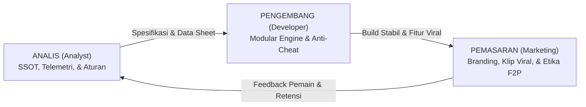

# Panduan & Aturan Pengembangan Aplikasi (Development Guidelines)
## Monopoli Enhanced Rule: Hostile Takeover & Dynamic Economy

> **Status:** Dokumen Resmi Panduan Tim Multidisiplin  
> **Sasaran:** Tim Pengembang (Developer), Analis Sistem & Desain Game (Analyst), serta Pemasaran & Komunitas (Marketing).  
> **Tujuan:** Menjaga keselarasan arsitektur teknis, konsistensi data desain, dan efektivitas peluncuran produk ke pasar multiplatform (Mobile, Roblox, PC Steam).

---



---

## 🛠️ Bagian 1: Aturan & Standar untuk DEVELOPER (Engineering)

Tujuan Developer adalah membangun game yang **ringan, bebas bug tumpang tindih, modular multiplatform (Unity C#, Roblox Lua, atau Qt C++), dan aman dari kecurangan**.

### 1. Pemisahan Mutlak: Logika Inti vs Tampilan Grafis (Engine-Agnostic)
* **Aturan Emas:** *Core Game Logic* (State Machine, perhitungan uang, sewa, dadu, kuota bangun, giliran, dan Berita RNG) **DILARANG KERAS** bercampur dengan kode grafis UI atau animasi engine.
* Gunakan pola **Command Pattern** atau fungsi murni (*Pure Logic Module*). 
* **Keuntungan:** Logika matematika game yang sama persis bisa dijalankan di server Node.js/C#, di-porting ke Roblox Lua, atau dibuatkan klien desktop Qt C++ tanpa perlu menulis ulang aturan transaksi.

### 2. Larangan Hardcode Angka (Data-Driven Configuration)
* **DILARANG** menaruh angka nominal (seperti harga tanah Rp 60 jt, sewa hotel, denda Rp 50 jt, kuota 2 rumah) langsung di dalam script *code*.
* Semua angka **WAJIB dibaca dari file konfigurasi data eksternal** (JSON/ScriptableObject) yang bersumber 1:1 dari `economy-sheet.md` dan `board-sheet.md`.
* Jika tim desain ingin mengubah harga rumah atau menaikkan denda, perubahan cukup dilakukan di file konfigurasi tanpa perlu *re-compile* seluruh aplikasi.

### 3. Integritas State Machine Petak & Transaksi Finansial
* Status petak harus selalu berada pada salah satu status resmi: `UNOWNED`, `SINGLE`, `COMPLEX`, `LANDMARK` (Mode Lama), `ACQUIRED` (dengan penanda `BROKEN_SET`). Obligasi Kawasan **bukan state** melainkan lapisan data di atas petak (pemegang, harga beli, status tebus).
* **Prinsip Transaksi Atomik:** Setiap perpindahan uang (sewa, caplok 2x, gaji Start, denda) harus bersifat atomik: jika kas pembayar tidak cukup, jalankan prosedur *Jual Darurat ke Bank 50%* terlebih dahulu; jika tetap kurang, baru eksekusi kebangkrutan. Uang tidak boleh "hilang di tengah jalan" tanpa pencatatan.

### 4. Otoritas Server & Penanganan Putus Koneksi (Multiplayer Architecture)
* **Server-Authoritative:** Klien HP/PC pemain tidak boleh menghitung hasil dadu atau mengurangi kas sendiri. Klien hanya mengirimkan *Intent/Input* (contoh: *"Pemain A menekan tombol Caplok"*), dan Server yang memvalidasi apakah uang mencukupi, mengeksekusi perpindahan hak milik, lalu menyiarkan *State Update* ke seluruh pemain.
* **Grace Period Disconnect:** Berikan toleransi penyambungan ulang (*reconnect*) selama **30 detik**. Jika waktu habis, peran pemain langsung digantikan oleh **Bot AI Mode Defensif** secara mulus tanpa menghentikan giliran pemain lain. Pemain asli dapat kembali mengambil kendali (*rejoin*) kapan saja.

### 5. Lokalisasi di Sisi Klien (Client-Side Rendering)
* Paket data jaringan yang dikirim server saat penarikan kartu cukup berupa:
  ```json
  { "cardId": "E01", "duration": 3, "targetTile": null }
  ```
* Teks jenaka (apakah Indonesia Medok Gaul *"Valuasi tanah ambles dadi -50%!"* atau English *"Property valuations plunge -50%!"*) diterjemahkan langsung di HP/PC masing-masing pemain sesuai setelan profilnya.

---

## 📊 Bagian 2: Aturan & Standar untuk ANALYST (System & Game Balance)

Tujuan Analis adalah memastikan **dokumen desain selalu menjadi kebenaran tunggal (*Single Source of Truth*), memantau data keseimbangan game, dan mencegah ambiguitas fitur**.

### 1. Prinsip Sumber Kebenaran Tunggal (Single Source of Truth - SSOT)
* Jika ada perbedaan angka atau aturan antara obrolan tim dengan dokumen, yang sah adalah yang tertulis di [GDD.md](./game-design/GDD.md) dan [economy-sheet.md](./game-design/economy-sheet.md).
* Setiap kali ada keputusan penyeimbangan baru (misal: denda kartu diubah atau durasi berita ditambah), analis **wajib memperbarui nomor versi dan log tanggal** pada dokumen terkait sebelum developer mulai mengoding.

### 2. Standar Notasi Diagram (Kepatuhan GLOBAL-00)
* Sesuai aturan arsitektur sistem proyek:
  * Diagram alur proses, interaksi antarkomponen, dan siklus status **wajib menggunakan Mermaid** (`flowchart TD/LR`, `stateDiagram-v2`, `sequenceDiagram`).
  * Notasi diagram harus membedakan antara aksi yang dilakukan oleh pemain (*User Task*) dengan aksi otomatis sistem/server (*Service Task*).

### 3. Pemasangan Pipa Telemetri & Analitik Keseimbangan (Game Analytics)
Analis wajib mendefinisikan *event tracking* yang harus ditanam developer ke dalam game:
* `match_start`: Mode yang dipilih (Cepat/Lama), jumlah pemain, tema visual.
* `takeover_executed`: Petak yang dicaplok, nilai valuasi, status kas korban setelah terima kompensasi 100%.
* `emergency_liquidation`: Seberapa sering pemain menggunakan fitur jual aset darurat ke Bank 50% untuk selamat dari kebangkrutan.
* `landmark_built` / `bond_purchased` / `bond_redeemed` / `scandal_triggered` *(Mode Lama, v0.6)*: biaya, komplek, dan apakah pemilik memilih bayar denda AMDAL atau merelakan 2 putaran sewa. Dipakai untuk menjawab Open Questions #11–#12 di GDD (apakah Landmark menurunkan atau menaikkan snowball; apakah ROI obligasi masuk akal).
* `dice_roll`: zona yang dibidik, zona hasil, dan flag `bullseye` — untuk memantau `bullseye_rate` (target ≤ 20%, Open Question #13).
* `match_end`: Menit berakhirnya game, alasan menang (Timer Net Worth / Capai Target 8.000 / Last Man Standing), dan rasio kekayaan akhir (Koefisien Gini).
* **Batas Toleransi Keseimbangan:** Kursi giliran bermain (kursi 1 sampai 4) harus memiliki tingkat kemenangan di rentang **22% – 28%**. Jika ada kursi yang konsisten menang >35%, analisis ulang urutan giliran atau pembagian tanah awal.

---

## 📢 Bagian 3: Saran & Strategi untuk MARKETING (Go-To-Market & Growth)

Tujuan Marketing adalah **menjual keunikan game, menggaet komunitas pemain, memaksimalkan momen viral, dan menjaga retensi tanpa merusak reputasi kompetisi**.

### 1. Positioning & Satu Kalimat Pembeda (The Elevator Pitch)
* Jangan pasarkan game ini sebagai "Sekadar Monopoli Biasa". Monopoli klasik punya stigma buruk: membosankan, kelamaan, dan bikin musuhan pasif.
* **Tagline Resmi:**
  > *"Monopoli modern di mana aset lawan bisa kamu caplok paksa kapan saja dengan uang tunai, dan krisis ekonomi mendadak bisa membalikkan nasib dalam satu lemparan dadu!"*
* **3 Nilai Jual Utama (Pillars):**
  1. **Anti Papan Macet (*No Board Lock*):** Lawan pelit barter? Tabung uang tunai, langsung caplok paksa 2x lipat!
  2. **Anti Sakit Hati Dini:** Korban caplok dapat uang tunai 100%, jadi punya modal buat balas dendam di putaran berikutnya.
  3. **Pilihan 2 Tempo:** Mau rusuh kilat 15 menit di jam istirahat sekolah/kantor (Mode Cepat), atau adu taktik negosiasi 45 menit saat mabar akhir pekan (Mode Lama).

### 2. Strategi Peluncuran Bertahap Multiplatform
* **Fase 1: Komunitas Roblox & Mobile (Android/iOS):**
  * Sasar kelompok usia 13–24 tahun.
  * Tonjolkan humor lokal kartu bilingual (istilah gaul: *"Ndilalah"*, *"Modyar"*, *"Sikat!"*, *"THR Cair"*).
  * Gandeng kreator konten Roblox dan gamer kasual untuk mabar interaktif bareng penonton (*viewers*).
* **Fase 2: Komunitas PC Steam & Discord Board Game:**
  * Sasar pecinta taktik usia 18–35 tahun yang mencari alternatif digital dari *Fortune Street* atau *Business Tour*.
  * Sorot aspek strategi cerdas: kalkulasi kapan harus pegang kas vs beli tanah, dan memanfaatkan krisis valuasi -50%.

### 3. Memanfaatkan Potensi Viralitas ("Momen Klip Medsos")
* Mekanik **Hostile Takeover 2x Lipat** dan **Berita Ekonomi Mendadak** adalah tambang emas untuk konten video pendek (TikTok, Instagram Reels, YouTube Shorts):
  * *Momen Konten:* Pemain lawan yang sombong karena punya komplek mewah bertingkat, tiba-tiba terkena kartu *Krisis Properti -50%*, lalu tanah kebanggaannya langsung dirampas paksa di depan matanya dengan sisa uang receh pemain lain!
  * **Saran Fitur ke Developer:** Buat tombol *"Bagikan Momen Caplok"* (auto-screenshot / klip 5 detik) di akhir aksi takeover yang bisa langsung diunggah ke media sosial pemain.

### 4. Kebijakan Monetisasi Etis (Strict Anti Pay-to-Win)
* Komunitas game papan digital sangat alergi terhadap transaksi uang yang memengaruhi adilnya lemparan dadu atau modal uang di atas papan.
* **Aturan Jualan Produk:**
  * **100% Kosmetik Visual:** Skin pion 3D beranimasi (Sultan Konglomerat, Mobil Balap Neon, Bebek Emas), Efek Jejak Dadu (Kristal Es, Api Membara), Tema Papan (Cyberpunk, Batavia Tempo Doeloe), serta Emote Stiker Meja interaktif.
  * **Taipan Pass (Tiket Musiman 30 Hari):** Hadiahkan variasi visual dan lencana prestise murni, tanpa ada penambahan saldo tunai awal atau dadu magnet.

---

### Matriks Kolaborasi Antar Divisi

| Situasi Proyek | Tugas Developer | Tugas Analyst | Tugas Marketing |
| :--- | :--- | :--- | :--- |
| **Fase 1: Pengerjaan MVP** | Membangun State Machine modular & Command Pattern tanpa hardcode angka. | Mengunci data sheet dan menyusun skenario uji (test cases). | Menyiapkan aset visual teaser, logo, dan landing page pengumuman. |
| **Fase 2: Alpha / Beta Test** | Menambal bug sinkronisasi multiplayer dan lag reconnect. | Membaca data telemetri: mengawasi win-rate tiap kursi dan durasi ronde. | Mengundang streamer/influencer micro untuk playtest bersama. |
| **Fase 3: Rilis Publik** | Memantau kestabilan server dan merilis patch perbaikan berkala. | Menganalisis kartu yang kurang laku atau terlalu OP untuk balance patch. | Mendorong kampanye klip TikTok dan peluncuran Taipan Pass Musim 1. |
