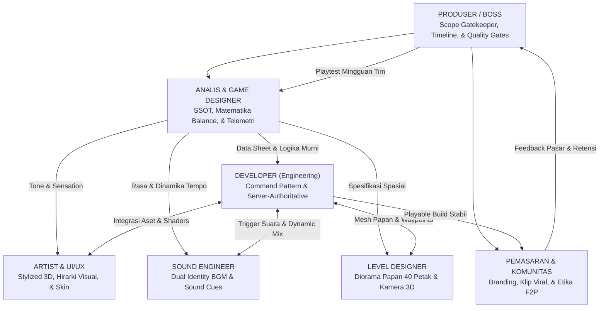

# Panduan & Aturan Pengembangan Aplikasi (Development Guidelines)
## Monopoli Enhanced Rule: Hostile Takeover & Dynamic Economy

> **Status:** Dokumen Resmi Panduan Tim Multidisiplin  
> **Sasaran:** Tim Pengembang (Developer), Analis & Desainer Game (Analyst), Sound Engineer & Komposer Audio, 2D/3D & UI/UX Artist, Level & Environment Designer, Pemasaran & Komunitas (Marketing), serta Produser & Pemimpin Proyek (Producer/Boss).  
> **Tujuan:** Menjaga keselarasan arsitektur teknis, konsistensi data desain, kepuasan estetika audio-visual, kelancaran navigasi level, dan ketepatan eksekusi rilis ke pasar multiplatform (Mobile, Roblox, PC Steam).

---



---

## 🛠️ Bagian 1: Aturan & Standar untuk DEVELOPER (Engineering)

Tujuan Developer adalah membangun game yang **ringan, bebas bug tumpang tindih, modular multiplatform (Unity C#, Roblox Lua, atau Qt C++), dan aman dari kecurangan**.

### 1. Pemisahan Mutlak: Logika Inti vs Tampilan Grafis (Engine-Agnostic)
* **Aturan Emas:** *Core Game Logic* (State Machine, perhitungan uang, sewa, dadu, kuota bangun, giliran, dan Berita RNG) **DILARANG KERAS** bercampur dengan kode grafis UI atau animasi engine.
* Gunakan pola **Command Pattern** atau fungsi murni (*Pure Logic Module*). 
* **Keuntungan:** Logika matematika game yang sama persis bisa dijalankan di server Node.js/C#, di-porting ke Roblox Lua, atau dibuatkan klien desktop Qt C++ tanpa perlu menulis ulang aturan transaksi.

### 2. Larangan Hardcode Angka (Data-Driven Configuration)
* **DILARANG** menaruh angka nominal (seperti harga tanah Rp 60 jt, sewa hotel, denda Rp 50 jt, kuota 2 rumah) langsung di dalam script *code*.
* Semua angka **WAJIB dibaca dari file konfigurasi data eksternal** (JSON/ScriptableObject) yang bersumber 1:1 dari [economy-sheet.md](./game-design/economy-sheet.md) dan [board-sheet.md](./game-design/board-sheet.md).
* Jika tim desain ingin mengubah harga rumah atau menaikkan denda, perubahan cukup dilakukan di file konfigurasi tanpa perlu *re-compile* seluruh aplikasi.

### 3. Integritas State Machine Petak & Transaksi Finansial
* Status petak harus selalu berada pada salah satu status resmi: `UNOWNED`, `SINGLE`, `COMPLEX`, `LANDMARK` (Mode Lama), `ACQUIRED` (dengan penanda `BROKEN_SET`). Obligasi Kawasan **bukan state** melainkan lapisan data di atas petak (pemegang, harga beli, status tebus).
* **Prinsip Transaksi Atomik:** Setiap perpindahan uang (sewa, caplok 2x, gaji Start, denda) harus bersifat atomik: jika kas pembayar tidak cukup, jalankan prosedur *Jual Darurat ke Bank 50%* terlebih dahulu; jika tetap kurang, baru eksekusi kebangkrutan. Uang tidak boleh "hilang di tengah jalan" tanpa pencatatan.

### 4. Otoritas Server & Penanganan Putus Koneksi (Multiplayer Architecture)
* **Server-Authoritative:** Klien HP/PC pemain tidak boleh menghitung hasil dadu atau mengurangi kas sendiri. Klien hanya mengirimkan *Intent/Input* (contoh: *"Pemain A menekan tombol Caplok"*), dan Server yang memvalidasi apakah uang mencukupi, mengeksekusi perpindahan hak milik, lalu menyiarkan *State Update* ke seluruh pemain.
* **Grace Period Disconnect:** Berikan toleransi penyambungan ulang (*reconnect*) selama **30 detik**. Jika waktu habis, peran pemain langsung digantikan oleh **Bot AI Mode Defensif** secara mulus tanpa menghentikan giliran pemain lain. Pemain asli dapat kembali mengambil kendali (*rejoin*) kapan saja.

### 5. Lokalisasi di Sisi Klien (Client-Side Rendering)
* Paket data jaringan yang dikirim server saat penarikan kartu cukup berupa:
  ```json
  { "cardId": "E01", "duration": 3, "targetTile": null }
  ```
* Teks jenaka (apakah Indonesia Gaul Ramah *"Valuasi tanah ambles dadi -50%!"* atau English *"Property valuations plunge -50%!"*) diterjemahkan langsung di HP/PC masing-masing pemain sesuai setelan profilnya.

---

## 📊 Bagian 2: Aturan & Standar untuk ANALYST & GAME DESIGNER (Balance & Systems)

Tujuan Analis adalah memastikan **dokumen desain selalu menjadi kebenaran tunggal (*Single Source of Truth*), memantau data keseimbangan game, dan mencegah ambiguitas fitur**.

### 1. Prinsip Sumber Kebenaran Tunggal (Single Source of Truth - SSOT)
* Jika ada perbedaan angka atau aturan antara obrolan tim dengan dokumen, yang sah adalah yang tertulis di [GDD.md](./game-design/GDD.md) dan [economy-sheet.md](./game-design/economy-sheet.md).
* Setiap kali ada keputusan penyeimbangan baru (misal: denda kartu diubah atau durasi berita ditambah), analis **wajib memperbarui nomor versi dan log tanggal** pada dokumen terkait sebelum developer mulai mengoding.

### 2. Standar Notasi Diagram (Kepatuhan GLOBAL-00)
* Sesuai aturan arsitektur sistem proyek:
  * Diagram alur proses, interaksi antarkomponen, dan siklus status **wajib menggunakan Mermaid** (`flowchart TD/LR`, `stateDiagram-v2`, `sequenceDiagram`).
  * Notasi diagram harus membedakan antara aksi yang dilakukan oleh pemain (*User Task*) dengan aksi otomatis sistem/server (*Service Task*).

### 3. Pemasangan Pipa Telemetri & Analitik Keseimbangan (Game Analytics)
Analis wajib mendefinisikan *event tracking* yang harus ditanam developer ke dalam game:
* `match_start`: Mode yang dipilih (Cepat/Lama), jumlah pemain, tema visual.
* `takeover_executed`: Petak yang dicaplok, nilai valuasi, status kas korban setelah terima kompensasi 100%.
* `emergency_liquidation`: Seberapa sering pemain menggunakan fitur jual aset darurat ke Bank 50% untuk selamat dari kebangkrutan.
* `landmark_built` / `bond_purchased` / `bond_redeemed` / `scandal_triggered` *(Mode Lama)*: biaya, komplek, dan apakah pemilik memilih bayar denda AMDAL atau merelakan 2 putaran sewa (Open Questions #11–#12).
* `dice_roll`: zona yang dibidik, zona hasil, dan flag `bullseye` — memantau `bullseye_rate` (target $\le 20\%$, Open Question #13).
* `match_end`: Menit berakhirnya game, alasan menang (Timer Net Worth / Capai Target 8.000 / Last Man Standing), dan rasio kekayaan akhir (Koefisien Gini).
* **Batas Toleransi Keseimbangan:** Kursi giliran bermain (kursi 1 sampai 4) harus memiliki tingkat kemenangan di rentang **22% – 28%**. Jika ada kursi yang konsisten menang >35%, analisis ulang urutan giliran atau pembagian tanah awal.

---

## 🎵 Bagian 3: Panduan untuk SOUND ENGINEER & KOMPOSER AUDIO (Acoustic Experience)

Tujuan Sound Engineer adalah menciptakan **umpan balik audio yang memuaskan (*tactile sensation*), dramatisasi momen kartu/caplok, serta identitas musikal yang khas tanpa mengganggu konsentrasi pemain**.

### 1. Dual Audio Identity (Identitas Musik per Tema)
* **Tema Mode Indonesia:**
  * *Instrumen Utama:* Petikan ukulele santai, kendang akustik lembut, flute bambu modern, dan bass akustik bergaya **Keroncong-Lofi santai**.
  * *Pacing:* Santai dan mengayun saat eksplorasi awal; bertransisi mulus menjadi ritme perkusi kontemporer yang intens saat sisa waktu 3 menit terakhir atau saat terjadi perang Caplok Paksa.
* **Tema Mode Internasional:**
  * *Instrumen Utama:* Sentuhan piano jazz modern, upright double-bass ritmik, dan brush snare beraroma **Urban Jazz-Lofi Lounge**.
  * *Pacing:* Elegan dan metropolitan pada fase awal; beralih ke brass crescendo dramatis saat memasuki fase endgame.

### 2. Desain Sound Cues (SFX Taktil & Sensasi Fisik)
* **Meteran Dadu Lingkaran (*Circular Gauge*):**
  * Suara *tick-tick-tick* mekanik yang meninggi saat tombol lempar ditahan (*Hold*).
  * Suara benturan dadu berat berbobot kayu padat di atas meja saat dilepas (*Release*).
  * Efek chime kristal *"Ting!"* yang sangat satisfying saat jarum berhenti tepat di zona **Perfect Bullseye**.
* **Transaksi Finansial & Kas:**
  * Suara denting koin *"Ka-ching!"* yang renyah saat menerima sewa atau bonus gaji START.
  * Suara pintu brankas besi berat saat mengeksekusi *Jual Darurat ke Bank 50%*.
  * Suara gemerincing koin tersedot saat membayar sewa komplek lawan.
* **Momen Ketegangan & Kejutan (Audio Stings):**
  * **Siaran Berita Global:** Sting orkestra dramatis ala berita televisi ("BREAKING NEWS sting") sesaat sebelum kartu Berita RNG diumumkan.
  * **Caplok Paksa (Hostile Takeover 2×):** Efek hantaman palu lelang berdentum atau petir menggelegar, disusul suara sirine alarm keuangan singkat.
  * **Penjara:** Suara pintu jeruji besi menutup dengan efek gema (*reverb*), diiringi suara sirene mobil patroli pendek.

### 3. Aturan Mixing & Kenyamanan Telinga (Mastering Standards)
* **Anti-Ear Fatigue:** Hindari frekuensi tinggi yang menusuk (*piercing highs* di atas 8 kHz) pada efek koin atau dadu, karena pemain akan mendengarnya ratusan kali dalam satu sesi.
* **Mix Hierarchy (Skala Prioritas Suara):**  
  `Voice/Announcer Cue (100%)` > `Critical Gameplay SFX (Takeover/News/Bullseye - 85%)` > `General SFX (Langkah pion/Beli tanah - 70%)` > `BGM Musik Latar (45%-55%)`.
* **Mobile-Safe Frequency:** Pastikan bass dan mid-range tetap terdengar jelas dan tidak pecah pada speaker mono/stereo smartphone standar tanpa earphone.

---

## 🎨 Bagian 4: Panduan untuk ARTIST & UI/UX DESIGNER (Visual Arts & Interface)

Tujuan Artist adalah menghasilkan visual **3D Isometrik Stylized yang cerah, kontras tegas, mudah dibaca sekilas (*high readability*), dan menggiurkan secara estetika kosmetik**.

### 1. Gaya Seni & Palet Warna (Stylized 3D Isometrik)
* **Referensi Estetika:** Mengadopsi visual *modern casual board game* (seperti *Business Tour* dan *Crossy Road*) — penuh warna, cerah, tidak gelap, dan ramah segala usia.
* **Kontras & Pencahayaan:** Gunakan bayangan lembut (*soft shadows*) dan pencahayaan hangat agar papan terlihat seperti meja mainan fisik premium.

### 2. Aksesibilitas Buta Warna (Colorblind-Safe Design)
* **Aturan Mutlak:** **DILARANG** mengandalkan warna semata untuk membedakan 8 distrik properti.
* **Heraldik Sekunder:** Setiap distrik warna wajib memiliki **ikon simbol unik** pada banner nama petak:
  * Distrik Cokelat: Simbol Biji Kopi / Bambu
  * Distrik Biru Muda: Simbol Gelombang Air
  * Distrik Merah Muda: Simbol Bunga Sakura
  * Distrik Oranye: Simbol Roda Gigi Industri
  * Distrik Merah: Simbol Mahkota Kerajaan
  * Distrik Kuning: Simbol Bintang Kejora
  * Distrik Hijau: Simbol Daun Semanggi
  * Distrik Biru Tua: Simbol Berlian Sultan
* Pemain dengan deuteranopia, protanopia, atau tritanopia harus bisa mengenali kepemilikan komplek hanya dari ikon tersebut.

### 3. Hirarki UI/UX & Feedback Layar
* **Keterbacaan Layar Kecil (Mobile 5.5 inci):** Papan 40 petak harus tetap dapat diidentifikasi kepemilikannya (warna bendera pemain + level bangunan) dari sudut pandang kamera standar.
* **HUD Ringkas & Bersih:**
  * Saldo kas pemain terpampang permanen di sudut layar dengan pemendek angka rapi (misal: `Rp 7.500 jt` atau `$7,500M`).
  * Timer giliran 20 detik berwujud lingkaran cahaya neon yang menyusut mengitari tombol aksi.
* **Modal Konfirmasi Dramatis:**
  * Jendela opsi **Caplok Paksa 2×** harus menampilkan perbandingan kas yang kontras: *"Bayar Sewa Biasa: Rp 250 jt"* vs *"Caplok Selamanya: Rp 1.400 jt (Sisa Kasmu: Rp 600 jt)"*.

### 4. Pipeline Kosmetik Visual (100% Non-Pay-to-Win)
* **Model 3D Pion Karakter:**
  * Siluet harus jelas dan ikonik dari sudut pandang atas (*top-down*).
  * Lengkapi tiap pion dengan 3 set animasi: *Idle Animation* (bergoyang santai), *Hop/Walk Animation* (melompat antusias tiap petak), dan *Victory Celebration* (animasi tarian kemenangan saat laga berakhir).
  * Varian rilis awal: Pion Sultan Konglomerat, Bebek Emas Klasik, Mobil Balap Neon, dan Kucing Hoki Emas.
* **Particle FX Memukau:**
  * Jejak pion (*Pawn Trails*): partikel salju, api membara, atau taburan uang kertas mini di belakang langkah pion.
  * Payout Sewa Besar: Ledakan partikel koin emas di tengah layar saat pemain menarik sewa hotel bernilai jumbo.

---

## 🏛️ Bagian 5: Panduan untuk LEVEL & ENVIRONMENT DESIGNER (Spatial & Board Experience)

Tujuan Level Designer adalah merancang **papan 40 petak yang terasa hidup seperti diorama miniatur kota, memiliki skala bangunan yang proporsional, serta navigasi kamera yang mulus**.

### 1. Papan Diorama Hidup (*Living Miniature Diorama*)
Area tengah papan tidak boleh dibiarkan menjadi karpet datar yang hampa. Papan adalah miniatur kota interaktif:
* **Papan Tema Indonesia:**
  * Tengah papan diisi lanskap perkotaan tropis: miniatur Monumen Nasional kecil, jalan layang dengan mobil angkot mini berlalu-lalang, jembatan kali kecil, pohon beringin rindang, dan kedai kopi pojok.
* **Papan Tema Internasional:**
  * Tengah papan diisi lanskap metropolit modern: miniatur Central Park hijau mini, trem listrik yang melingkar perlahan, dan gedung pencakar langit berpadu kaca reflektif.

### 2. Skala Modular Bangunan (Modular Tile Meshes)
* **Proporsi Petak:** Petak properti harus memiliki grid dudukan bangunan yang presisi agar penambahan rumah tidak menutupi nama jalan atau ikon heraldik.
* **Rumah Tingkat 1 sampai 4:** Menggunakan model modular mungil bertingkat yang tersusun rapi berdampingan.
* **Hotel:** Bangunan megah 2 lantai yang menggantikan 4 rumah dengan atap warna mencolok.
* **Landmark (Mode Lama):**
  * Bangunan pencakar langit prestisius atau monumen megah yang mendominasi petak.
  * **Indikator Kebal Caplok:** Landmark wajib memiliki visualisasi pelindung khusus (aura pilar tameng emas melingkar atau kubah arsitektur khas) sehingga lawan dari kejauhan langsung mengerti bahwa petak ini tidak dapat dicaplok dengan uang tunai.

### 3. Sinematografi Kamera Dinamis (Dynamic Camera Framing)
* **Kamera Utama (Overview Mode):** Sudut 45 derajat isometrik yang mengunci 1 kuadran aktif dengan framing stabil dan tajam.
* **Kamera Meluncur (*Smooth Tracking Pan*):** Saat pion melompat sesuai angka dadu, kamera meluncur halus mengimbangi pergerakan pion tanpa getaran yang memicu mabuk visual (*motion sickness*).
* **Kamera Aksi Singkat (*Dramatic Event Close-up*):**
  * Saat eksekusi Caplok Paksa 2× atau pendaratan di petak Landmark, kamera memotong ke sudut rendah dramatis (*cinematic low-angle*) selama **1,2 detik**, lalu segera kembali ke posisi gameplay agar tidak memperlambat tempo permainan.

---

## 📢 Bagian 6: Saran & Strategi untuk MARKETING (Go-To-Market & Growth)

Tujuan Marketing adalah **menjual keunikan game, menggaet komunitas pemain, memaksimalkan momen viral, dan menjaga retensi tanpa merusak reputasi kompetisi**.

### 1. Positioning & Satu Kalimat Pembeda (The Elevator Pitch)
* Jangan pasarkan game ini sebagai "Sekadar Monopoli Biasa". Monopoli klasik punya stigma buruk: membosankan, kelamaan, dan bikin musuhan pasif.
* **Tagline Resmi:**
  > *"Monopoli modern di mana aset lawan bisa kamu caplok paksa kapan saja dengan uang tunai, dan krisis ekonomi mendadak bisa membalikkan nasib dalam satu lemparan dadu!"*
* **3 Nilai Jual Utama (Pillars):**
  1. **Anti Papan Macet (*No Board Lock*):** Lawan pelit barter? Tabung uang tunai, langsung caplok paksa 2x lipat!
  2. **Anti Sakit Hati Dini:** Korban caplok dapat uang tunai 100%, jadi punya modal buat balas dendam di putaran berikutnya.
  3. **Pilihan 2 Tempo:** Mau rusuh kilat 15 menit di jam istirahat sekolah/kantor (Mode Cepat), atau adu taktik negosiasi 45 menit saat mabar akhir pekan (Mode Lama).

### 2. Strategi Peluncuran Bertahap Multiplatform
* **Fase 1: Komunitas Roblox & Mobile (Android/iOS):**
  * Sasar kelompok usia 13–24 tahun.
  * Tonjolkan humor lokal kartu bilingual (istilah gaul: *"Ndilalah"*, *"Modyar"*, *"Sikat!"*, *"THR Cair"*).
  * Gandeng kreator konten Roblox dan gamer kasual untuk mabar interaktif bareng penonton (*viewers*).
* **Fase 2: Komunitas PC Steam & Discord Board Game:**
  * Sasar pecinta taktik usia 18–35 tahun yang mencari alternatif digital dari *Fortune Street* atau *Business Tour*.
  * Sorot aspek strategi cerdas: kalkulasi kapan harus pegang kas vs beli tanah, dan memanfaatkan krisis valuasi -50%.

### 3. Memanfaatkan Potensi Viralitas ("Momen Klip Medsos")
* Mekanik **Hostile Takeover 2x Lipat** dan **Berita Ekonomi Mendadak** adalah tambang emas untuk konten video pendek (TikTok, Instagram Reels, YouTube Shorts):
  * *Momen Konten:* Pemain lawan yang sombong karena punya komplek mewah bertingkat, tiba-tiba terkena kartu *Krisis Properti -50%*, lalu tanah kebanggaannya langsung dirampas paksa di depan matanya dengan sisa uang receh pemain lain!
  * **Saran Fitur ke Developer:** Buat tombol *"Bagikan Momen Caplok"* (auto-screenshot / klip 5 detik) di akhir aksi takeover yang bisa langsung diunggah ke media sosial pemain.

### 4. Kebijakan Monetisasi Etis (Strict Anti Pay-to-Win)
* Komunitas game papan digital sangat alergi terhadap transaksi uang yang memengaruhi adilnya lemparan dadu atau modal uang di atas papan.
* **Aturan Jualan Produk:**
  * **100% Kosmetik Visual:** Skin pion 3D beranimasi, Efek Jejak Dadu, Tema Papan (Cyberpunk, Batavia), serta Emote Stiker Meja interaktif.
  * **Taipan Pass (Tiket Musiman 30 Hari):** Hadiahkan variasi visual dan lencana prestise murni, tanpa ada penambahan saldo tunai awal atau dadu magnet.

---

## 👑 Bagian 7: Aturan untuk PRODUCER & STUDIO BOSS (Executive & Delivery Gates)

Tujuan Produser / Pemimpin Proyek adalah **menjaga fokus tim, menahan pembengkakan fitur (*scope creep*), memastikan jadwal rilis tepat waktu, serta menjamin kepuasan bermain sejak hari pertama**.

### 1. Penjaga Gawang Fitur (Strict Scope Gatekeeper)
* **Prioritas Mutlak MVP v1.0:** Rilis pertama HANYA memuat:
  1. Dua mode tempo: Mode Cepat (15 mnt) dan Mode Lama (45 mnt).
  2. Sirkuit ekonomi tertutup (closed-loop) + Hostile Takeover 2× + Jual Darurat ke Bank 50%.
  3. Dadu *Circular Gauge* (Kecil/Sedang/Besar + Bullseye refleks).
  4. 49 Dek Kartu Dwibahasa (9 Berita RNG, 20 Dana Umum, 20 Kesempatan).
  5. Papan 40 petak (Tema Indonesia & Internasional).
* **Penahanan Ide Kompleks (Karantina §10):**
  * Ide-ide canggih seperti **Pasar Saham Distrik, Pinjaman Bank Berbunga, Dewan Kota, Upkeep, dan Spesialisasi Hotel** telah dikunci rapi di [§10 GDD.md](./game-design/GDD.md).
  * **DILARANG** memasukkan modul §10 ke dalam sprint pengerjaan v1.0 sebelum versi MVP terbukti stabil dan menguntungkan di pasar.

### 2. Ritme Kerja & "Playtest Jumat Sore" (Weekly Friday Playtest)
* Setiap hari Jumat sore pukul 15.30, **seluruh pemimpin divisi (Dev, Analyst, Art, Audio, Level, Marketing, PM) WAJIB duduk bersama dan memainkan minimal 1 sesi Mode Cepat & 1 sesi Mode Lama**.
* Tidak ada dokumen atau grafik yang bisa menggantikan *game feel* langsung. Jika tim sendiri tidak merasa seru dan tertawa saat memainkan build minggu itu, jangan harap pemain luar akan menyukainya.

### 3. Pintu Gerbang Kualitas Rilis (Quality Gates)
Sebelum aplikasi dinyatakan lolos ke tahap *Public Launch*, game harus melewati 4 gerbang verifikasi:
* **Gate 1 — Durasi Nyata:** 90% sesi uji coba Mode Cepat selesai dalam rentang **12–16 menit** (maksimal 18 menit pada kondisi pemain paling lambat).
* **Gate 2 — Kestabilan Spek:** Aplikasi berjalan mulus minimal **60 FPS** tanpa memory leak pada perangkat acuan Android RAM 3 GB dan Roblox low-end.
* **Gate 3 — Keadilan Kursi (Seat Fairness):** Data telemetri membuktikan tingkat kemenangan kursi 1 sampai 4 berada dalam toleransi seimbang **22% – 28%**.
* **Gate 4 — Audit Monetisasi Bersih:** Memastikan tidak ada satu pun item toko yang menjual saldo uang, dadu akurat instan, atau proteksi sewa berbayar. Reputasi studio di atas segalanya.

---

## 🤝 Matriks Kolaborasi Lintas Disiplin Antar Fase

| Fase Proyek | Producer / Boss | Analyst & Game Design | Developer (Engineering) | Sound Engineer | Artist & UI/UX | Level Designer | Marketing |
| :--- | :--- | :--- | :--- | :--- | :--- | :--- | :--- |
| **Fase 1: Fondasi MVP** | Mengunci scope v1.0 & memblokir ide liar. | Finalisasi data sheet & skenario test case. | Bangun State Machine & Command Pattern modular. | Bikin SFX inti (dadu, koin, sting berita). | Rancang UI HUD & palet distrik buta warna. | Buat blockout 3D 40 petak & waypoints pion. | Siapkan teaser logo & amankan media sosial. |
| **Fase 2: Playtest & Polish** | Evaluasi hasil Playtest Jumat Sore mingguan. | Analisis telemetri win-rate kursi & durasi 15/45m. | Benahi netcode reconnect 30s & bot AI pengganti. | Mastering audio mobile & aransemen BGM lofi. | Polishing animasi pion & efek partikel caplok. | Percantik diorama tengah papan (Indo & Int). | Gandeng micro-streamer untuk sesi mabar perdana. |
| **Fase 3: Rilis Publik** | Evaluasi metrik retensi D1/D7/D30 & laba. | Analisis kartu yang underused/OP untuk balancing. | Pantau server crash log & rilis patch kilat. | Update sound pack musiman di masa depan. | Siapkan variasi skin pion untuk Taipan Pass. | Eksplorasi layout papan musiman (Cyberpunk). | Gaspol klip viral TikTok & rilis Taipan Pass S1. |
