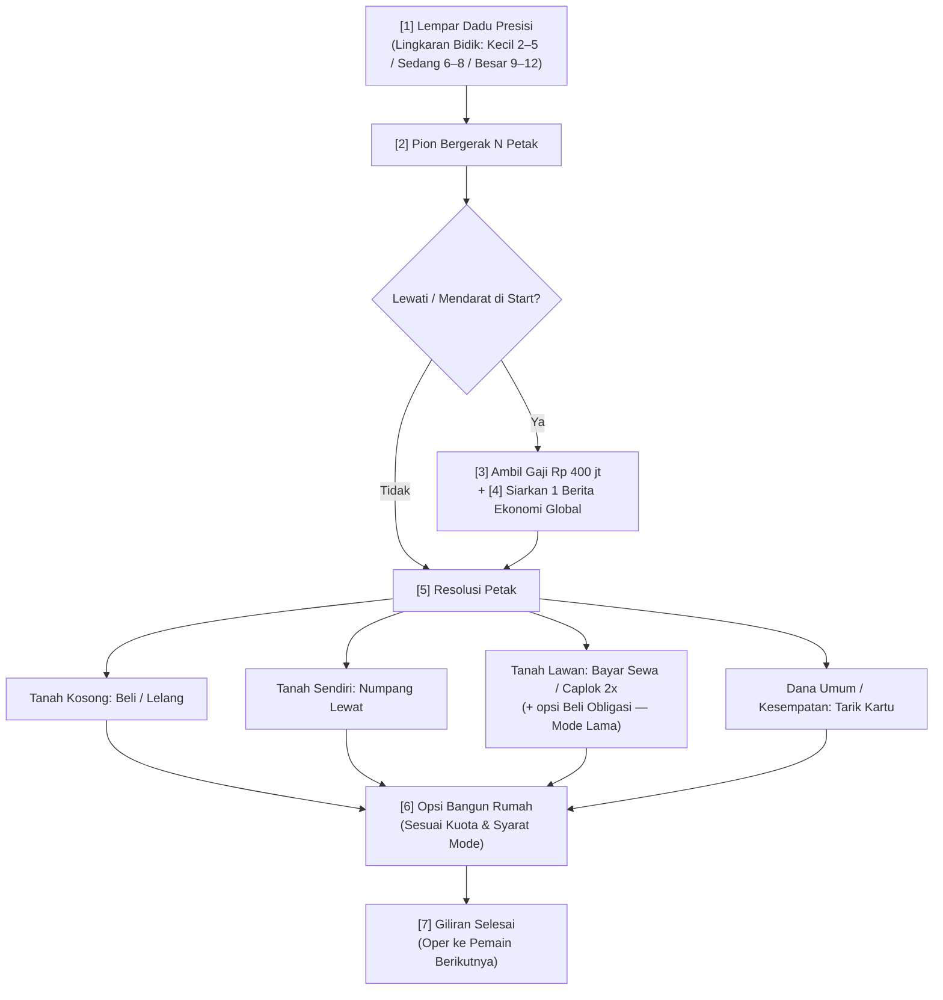
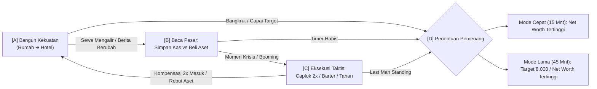
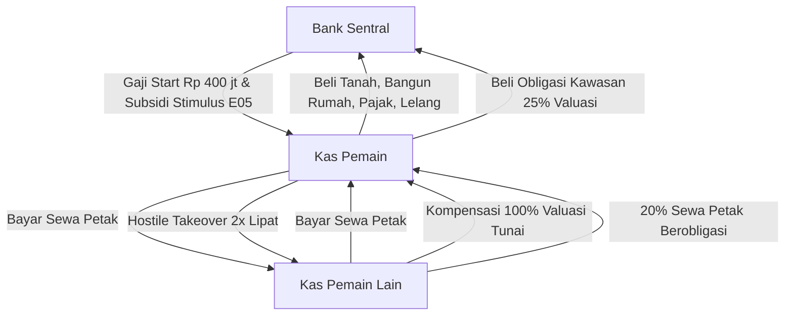
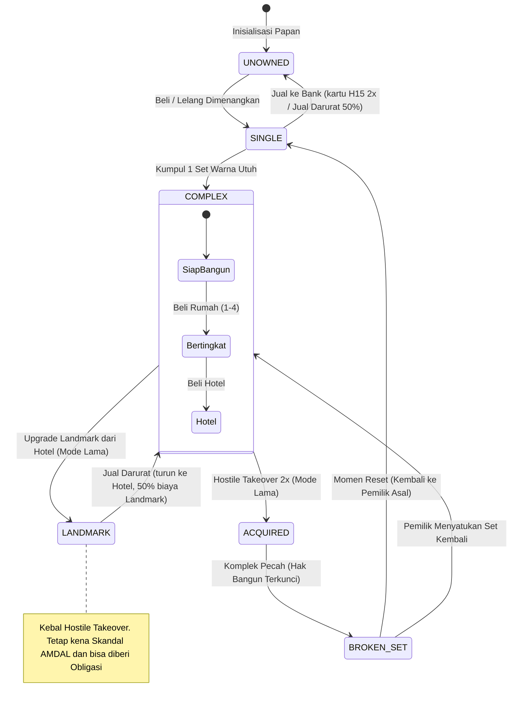
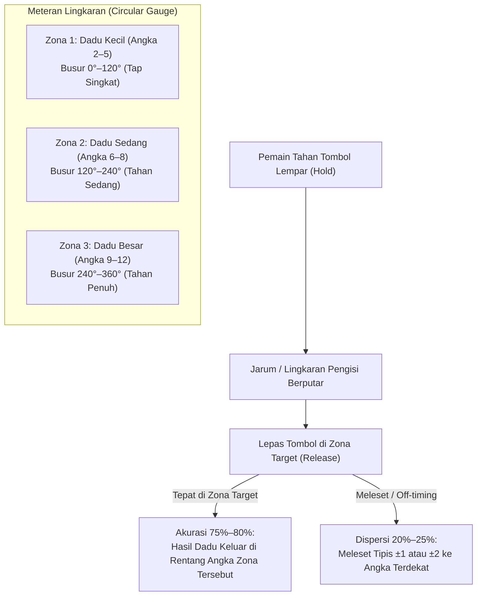
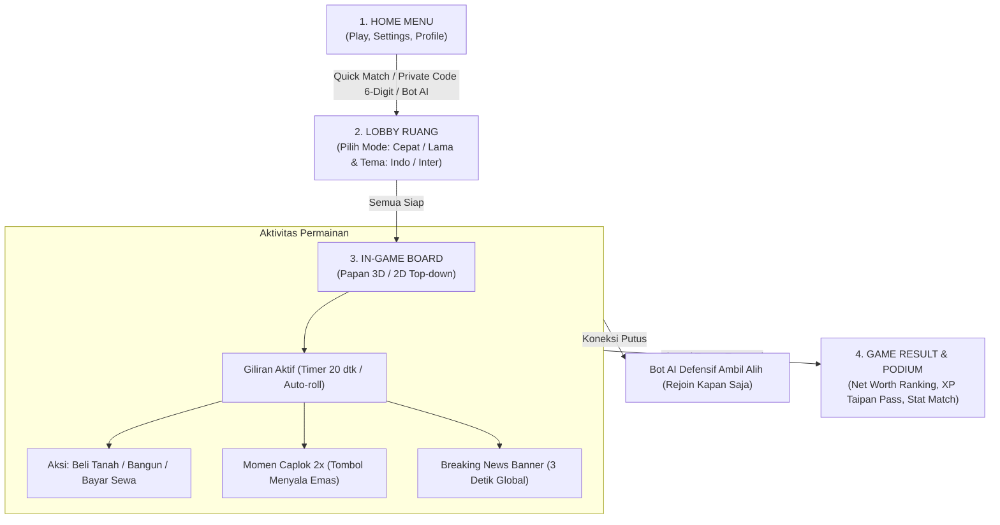

# GDD — Monopoli Enhanced Rule (Hostile Takeover & Dynamic Economy)

> **Status:** Living Doc **v0.7** — Struktur Hybrid (Master + Lampiran)

> **Revisi v0.7 (2026-11-07) — Catatan Roadmap Modular Masa Depan (§10):** mendokumentasikan 6 sistem kedalaman tinggi (Pasar Saham Distrik, Fasilitas Kredit Bank & Agunan, Percabangan Spesialisasi Hotel, Biaya Upkeep/Maintenance, Dewan Kota & Referendum Kebijakan, Polis Asuransi Properti) sebagai *backlog modular / DLC / Mode Pro* agar tidak mengorbankan kesederhanaan dan stabilitas rilis inti (MVP v1.0).  
> **Revisi v0.6 (2026-11-07) — Lapisan Kompleksitas Mode Lama:** ditambah **Landmark** (kebal caplok), **Obligasi Kawasan** (bagi hasil sewa 20%), berita **E09 Skandal AMDAL** (valve anti-snowball), dan **Perfect Bullseye + Express Pass** pada dadu lingkaran (§3.8, §3.11–3.13). Semua angka tambahan berlabel `[asumsi — belum disimulasikan]`: folder playtest-sim sudah dihapus, jadi dampak ke balance Mode Lama (yang terakhir terukur 🔴 blowout 57%) **belum terverifikasi** — lihat Open Questions #11–#13.  
> **Revisi v0.5 (2026-11-07):** Fase 2 aturan diimplementasi + diverifikasi di playtest-sim (23/23 unit test): berita RNG E01–E08 + stacking, kartu 48 (Cepat: tunai ×5, tanpa kartu barter), hostile takeover 2× (Mode Lama), penjara asli (maks 2 giliran), lelang tanah kosong [asumsi OQ#4], dadu kembar = roll ulang. **OQ#8 DITUTUP: urutan giliran diacak per sesi** — seat spread turun ke 3,4% (Cepat) / 4,0% (Lama). Kalibrasi ulang Mode Lama: target 8.000 tetap rekomendasi (400 run). Temuan baru: (a) edge posisi giliran pertama di Cepat 34% vs 17% terakhir (OQ#10); (b) Mode Lama bucket campur kini 🔴 blowout 57% — biang = caplop (−22pp saat dimatikan; lihat LAPORAN-2026-11-07).  
> **Tanggal:** 2026-10-24  
> **Revisi v0.4 (2026-10-24):** ending kedua mode dikunci via playtest-sim (lihat §2 Ending & log [`economy-sheet.md`](./economy-sheet.md) §4): Mode Cepat = **timer keras 15 menit seragam, pemenang = Net Worth** (3 hotel = milestone); Mode Lama = **timer 45 menit + Net Worth target 8.000 juta (terkalibrasi sim)**; modal dikunci Cepat 7.500+2 petak / Lama 2.000 (OQ #5 ditutup); target lama “50 Miliar” dibuang (terbukti mustahil — 0/1.200 run).  
> **Struktur:** Master ini berisi narasi & keputusan 10 section; data padat di lampiran terpisah: [`kartu-draft.md`](./kartu-draft.md) (49 kartu) · [`board-sheet.md`](./board-sheet.md) (40 petak × 2 tema) · [`economy-sheet.md`](./economy-sheet.md) (tabel sewa + log playtest)  
> **Input:** [`question-framework.md`](./question-framework.md) (100% terjawab)  
> **GATE:** [NOTATION.md](http://NOTATION.md) GLOBAL-00 disepakati — 2026-10-24 (drill scope: game design, FUNCTIONAL, batch)  
> **Catatan hidup:** GDD ini berubah via playtest — bukan change request. Update versi + tanggal tiap iterasi.

 *

## Research Notes (§2 Research Protocol)

| Aspek | Temuan Riset | Sumber | Dampak ke GDD |
| :--- | :--- | :--- | :--- |
| **Masalah Monopoli klasik** | 4 penyakit utama: runaway leader (positive feedback tanpa penahan), player elimination membosankan, kingmaking via trade, durasi 60–180 menit dengan keputusan sedikit. BGG rating 4.36/10 dari 25rb+ review. | [BBC Future](https://www.bbc.com/future/article/20200219-why-monopoly-is-such-a-bad-game), [Brandon the Game Dev](https://brandonthegamedev.com/7-lessons-from-monopoly-for-aspiring-board-game-designers/), [The Dish](https://dish.andrewsullivan.com/2015/01/10/bored-games/) | Menjadi daftar “yang dibuang”: board lock dipecah Hostile Takeover + Berita; eliminasi dini dikompensasi 2x kas; sesi dipangkas Mode Cepat 10–15 mnt |
| **Model akuisisi paksa** | *Fortune Street*: forced buyout 5x valuasi + lapis saham; *LINE Let’s Get Rich*: takeover 2x lipat biaya beli+bangun, Landmark kebal. Rasio 2x terbukti dipakai game mobile sukses. | [GamesRadar Fortune Street](https://www.gamesradar.com/fortune-street-review/), [Nintendo Life](https://www.nintendolife.com/reviews/2011/12/fortune_street_wii) | Formula takeover dikunci 2x lipat valuasi (lebih ramah dari 5x Fortune Street) |
| **Durasi sesi digital board game** | BGA: rata-rata 42 mnt/sesi; strategy game 47 mnt; Catan 62 mnt; Monopoly digital ~35 mnt vs fisik 60+. Mobile sukses di sesi mikro. | [BGA data 2025](https://www.boardgamearenagame.com/table-games/), [Oryx Capital](https://oryx-capital.com/the-rise-of-digital-monopoly-games-innovation-strategy-and-market-/) | Mode Cepat 10–15 mnt & Mode Lama 30–45 mnt realistis & kompetitif |
| **Papan & probabilitas mendarat** | Analisis Markov papan Monopoli: distribusi tidak merata — petak sekitar 6–8 langkah dari Start (oranye/merah) paling sering kena; Penjara = petak paling sering didatangi. | [Ian Stewart, Scientific American (PDF)](https://abel.math.harvard.edu/archive/21b_fall_05/Articles/monopolyrevisited.pdf) | §5 bubblemap intensitas mendarat — petak 6–8 jadi kawasan konflik takeover |
| **Monetisasi digital board game** | 29 dari 31 app board game ternama = pay-once (median $8.99); F2P nyaris tidak ada karena aturan game sudah "utuh & publik" — monetisasi merusak keseimbangan. Monetisasi F2P sukses hanya dengan kosmetik (Monopoly GO!$5M dalam 2 tahun, tapi sebagai pengalaman berbeda total). | [Gap analysis 50 judul](https://boardgame.toriumis.com/en/), [Forbes Monopoly GO!](https://www.forbes.com/sites/dbloom/2025/05/01/monopoly-go-passes-5-billion-in-two-years-but-journey-wasnt-easy/) | F2P kosmetik murni dipertahankan; Taipan Pass tidak boleh menjual keuntungan mekanik |
| **Pacing mode cepat** | *Machi Koro*: 30 menit, engine-building ringan tanpa eliminasi; *Kingdomino* mobile: sesi 15 menit dengan variasi aturan. | [Nerdist Machi Koro](https://nerdist.com/article/machi-koro-why-you-can-set-fire-to-your-monopoly-set/), [Pocket Gamer Kingdomino](https://www.pocketgamer.com/kingdomino/out-now/) | Validasi tangga bangun bertahap (2→4→hotel) sebagai pacing anti death-trap |
| **Landmark, hazard & saham (v0.6)** | *LINE Let's Get Rich*: properti yang sudah jadi Landmark tidak bisa diakuisisi (hasil pencarian web, sumber medium.com). *Monopoly City* (bangunan pengganggu/hazard) dan *Fortune Street* (saham distrik, dividen) dirangkum subagent **dari pengetahuan umum — koneksi browser gagal, tanpa URL**; detailnya belum diverifikasi ke sumber primer. | — (belum ada URL primer) | Landmark kebal caplok (§3.11); Obligasi Kawasan = versi ringan dividen Fortune Street (§3.12); AMDAL = adaptasi ide hazard (§3.13). Mekanik adaptasi, bukan salinan aturan asli. |

> Semua angka balance di §3 berlabel **`[asumsi — perlu playtest]`** kecuali disebut lain.

 *

## §1 High Concept

**Monopoli Enhanced Rule** adalah game papan digital 2–4 pemain yang mengambil kerangka Monopoli klasik (40 petak, dadu, properti, sewa) lalu menyuntiknya tiga keping mekanik modern: **Akuisisi Paksa 2x lipat** (mendarat di komplek lawan boleh bayar sewa ATAU bayar dua kali lipat valuasi untuk mencaploknya — kompensasi 100% mengalir ke pemilik lama sehingga tidak ada eliminasi dini yang sia-sia), **Matras 2 Mode** (Mode Cepat 10–15 menit tanpa syarat kompleks + tangga bangun bertahap; Mode Lama 30–45 menit wajib berkompleks + barter P2P), dan **Berita Ekonomi RNG global** yang disiarkan setiap pemain melewati Start (krisis -50%, booming sewa, pajak likuiditas, moratorium bangun) sehingga papan tidak pernah membeku.

> **Satu kalimat pembeda:** “Monopoli modern di mana aset lawan bisa kamu caplok paksa kapan saja dengan uang tunai, dan krisis ekonomi mendadak bisa membalikkan nasib dalam satu lemparan dadu!” — berbeda dari *Fortune Street* (buyout 5x + saham, tanpa berita global), *Business Tour* (dadiu aksesoris & mini-game, tanpa akuisisi), dan Monopoli klasik (board lock + eliminasi).

**Aesthetic target (dari framework F):Challenge** (prioritas 1 — mengelola likuiditas & timing caplok) + **Fellowship** (prioritas 2 — ledakan reaksi sosial saat properti direbut). Sengaja mengorbankan Narrative; WAJIB mencegah *Unwanted Submission* (pasrah dadu tanpa opsi perlawanan).

 *

## §2 Core Gameplay Loop

### Loop Mikro (satu giliran, ±20–40 detik)



**Tag aesthetic:** \[1\] Sensation (feel dadu) · \[4\] Discovery/Challenge (kabar datang = peluang atau ancaman) · \[5\] Challenge (keputusan beli/caplok/bayar) · \[6\] Challenge (timing bangun vs tabung kas).

### Loop Sesi (15 mnt Mode Cepat / 45 mnt Mode Lama — keputusan 2026-10-24)



**Ending (KEPUTUSAN REVISI 2026-10-24 — diuji playtest-sim, lihat log economy-sheet §4):**

*   **Mode Cepat:** timer keras **15 menit seragam untuk semua jumlah pemain** — sesi SELALU main penuh 15 menit; 3 hotel = **milestone**, bukan kemenangan. **Pemenang = Net Worth (tanah + bangunan + kas) tertinggi di menit 15.** Shortcut: tersisa 1 pemain solven → menang langsung (Last Man Standing, hasil sama dengan nunggu timer). Seri Net Worth → kas tunai terbanyak menang → masih seri → adu 1 dadu.
*   **Mode Lama:** timer **45 menit** + end alami: Net Worth **≥ 8.000 juta** (target terkalibrasi sim: crossing median menit 35, terpicu di ~23% game) ATAU tersisa 1 pemain (LMS). Seri Net Worth di timer → tie-break sama dengan Mode Cepat.
Alasan perubahan dari v0.3 (“3 hotel menang” / “50 Miliar”):* ending berbasis “siapa nyampe duluan” memicu **tie di garis finish di 26–33% game** + first-mover edge (kursi 0 menang 40% vs kursi 3 9%); target 50 Miliar **terbukti mustahil** (total suplai uang ≈ 39.000 juta — 0/1.200 run nyentuh). Dengan timer + Net Worth, semua pemain dinilai di garis waktu yang sama. Hasil sim ulang: Mode Cepat 8/8 bucket 🟢 FAIR, Mode Lama durasi 42 mnt (target 35–45 ✓).

### Loop Meta (di luar sesi — tipis, v1)

Profil ringan: menang → naik level akun → unlock kosmetik (Taipan Pass XP) → main lagi. Tidak ada progres yang mengubah kekuatan di papan (anti pay-to-win).

### Sirkuit tertutup uang (Aturan 116 — audit loop)



Obligasi dan Landmark **tidak menambah uang baru**: harga obligasi masuk ke Bank, sedangkan bagi hasil 20% diambil dari sewa yang memang sudah dibayar (pemilik petak menerima 80%).

Uang **tidak pernah diciptakan dari nol selain gaji Start & stimulus** — sirkuit tertutup; inflasi dikendalikan berita E08 & pajak likuiditas. Tidak ada loop resource-saja yang periodik membosankan: tiap sirkuit bawa pengubah nilai (berita, kartu, status komplek).

 *

## §3 Mechanics Detail

### 3.1 State Machine Petak (inti engine)



*   **3 flag mode saja:** `requireComplex` (F/T), `allowHostileTakeover` (F/T), `useLapBuildCap` (F/T). Satu mesin untuk Unity C# / Roblox Lua / Qt C++. **Landmark, Obligasi Kawasan, dan berita E04/E09 tidak menambah flag baru** — semuanya ikut `allowHostileTakeover` (aktif hanya di Mode Lama).
*   **Obligasi bukan state petak** — ia lapisan (overlay) di atas state yang ada, jadi state machine tetap 4 status + `LANDMARK`.
*   **Tag aesthetic:** Challenge — tiap transisi adalah keputusan, bukan otomatisasi.

### 3.2 Bangun Rumah & Tangga Bertahap (keputusan framework C)

| Mode | Aturan |
| :--- | :--- |
| **Cepat** | NO COMPLEX RULE — beli rumah di petak tunggal. Kuota **per petak per sesi personal** (sesi = pemain sendiri lewat Start): sesi 1 = maks **2 rumah** → sesi 2 = maks **4 rumah** → sesi 3+ = **1 hotel** (syarat 4 rumah). |
| **Lama** | WAJIB berkompleks (satu set warna utuh) — tanpa kuota sesi, bangun bebas. |

*   **Harga rumah (skala Kompleks A–H):** makin mahal tanah kompleks, makin mahal rumahnya — **A (Cokelat)=50 · B (Biru Muda)=75 · C (Merah Muda)=100 · D (Oranye)=125 · E (Merah)=150 · F (Kuning)=175 · G (Hijau)=200 · H (Biru Tua)=225 jt/rumah**; upgrade ke **Hotel = 4 rumah + 1× harga rumah kompleks** (total investasi 5× harga rumah kompleks).
*   **Jual Darurat ke Bank (50%):** saat kas tidak cukup membayar sewa/denda, pemain dapat menjual rumah maupun melepas sertifikat tanah kosong balik ke Bank seharga **50% harga beli asli** sebelum dinyatakan bangkrut.
*   Kartu Diskon material (H03) & Stimulus (E05) menurunkan biaya bangun — berlaku kapan saja.

### 3.3 Akuisisi Paksa (Mode Lama saja)

*   **Biaya** = `[Harga Beli Tanah + (Jumlah Rumah × Harga Rumah Kompleks)] × 2`, tunai 100% ke pemilik lama.
*   Saat **Krisis Properti (E01)** aktif: valuasi ×0.5 dulu → biaya efektif = valuasi normal. Momen emas.
*   **Maksimal 1 akuisisi per giliran** (anti babat papan).
*   **Bangunan ikut utuh** ke pencaplok (insentif agresif); korban dapat kas masif untuk balas.
*   **Broken Set:** setelah dicaplop, hak bangun warna itu terkunci, saudara warna turun ke tarif tunggal.
*   **Momen reset:** jika petak komplek pernah dicaplop dan kembali ke pemilik asli → status balik \[SINGLE\]/sesi 1 (hanya Mode Lama).
*   **Anti-kingmaking:** pemain bangkrut → asetnya dilelang ke Bank (bukan diwariskan ke lawan pilihan).
*   **Tag aesthetic:** Challenge + Fellowship — momen paling dramatis di meja.

### 3.4 Tabel Sewa Awal

Rumus turunan: `Sewa n rumah ≈ SewaDasar × 10^(n-1) × 1.5` dibulatkan; hotel ≈ 4–5× rumah ke-4; **komplek utuh menggandakan semua tarif** (klasik). **Tabel sewa lengkap 8 kompleks + stasiun + utilitas + formula → [`economy-sheet.md`](./economy-sheet.md)** (seluruh angka berlabel `[asumsi — perlu playtest]`).

### 3.5 Berita Ekonomi RNG (global — [`kartu-draft.md`](./kartu-draft.md) sub-deck E01–E09)

*   **Pemicu:** setiap pemain melewati/mendarat di Start (bareng gaji).
*   **Durasi:** 2–3 putaran penuh (dihitung sejak giliran pemecah berita); sejenis memperpanjang (maks 5), bertolak belakang menetralkan, beda kategori paralel.
*   9 berita: Krisis Properti −50% · Booming Sewa ×2 · Pajak Likuiditas 30% · Hot Takeover −25% (Lama) · Stimulus +200 & diskon 20% · Resesi Sewa −50% · Moratorium Bangun · Inflasi Liar (gaji ×2, sewa +50%) · **Skandal AMDAL (Lama): komplek termahal disegel, sewa 0 selama 2 putaran kecuali pemilik bayar denda 20% valuasi** — Mode Cepat memakai 7 berita (tanpa E04 & E09).
*   **Tag aesthetic:** Discovery (apa kabar berikutnya?) + Challenge (adaptasi).

### 3.6 Kartu (49 kartu — detail penuh di [`kartu-draft.md`](./kartu-draft.md))

*   **Dana Umum 20 (C01–C20):** arus kas pribadi, saweran ulang tahun/kondangan, Surat Sakti Lurah (bebas penjara, bisa di-trading).
*   **Kesempatan 20 (H01–H20):** gerakan pion, renovasi, voucher takeover, SHM tangkal caplop, tukar guling, masuk penjara, judi dadu.
*   **4 kartu simpanan taktis** (H03 diskon bangun, H08 tameng takeover, H12 voucher takeover, H17 bebas sewa) → menambah lapis taktik & bahan barter.
*   Bilingual **Indonesia Gaul Ramah** (slang nasional, tanpa medok berat) + EN; engine kirim `cardId` + parameter, teks locale di client.
*   **2 Theme Variant (KEPUTUSAN 2026-10-24): Indonesia Mode vs International Mode** — murni lapisan presentasi (nama 40 petak, skin papan, musik, teks kartu, simbol mata uang tampilan), **aturan 100% identik** (satu state machine, tanpa flag mode tambahan). **Tema mengikuti room — satu meja satu tema, DILARANG campur** (room Indonesia = semua pemain lihat tema Indonesia; room International = semua lihat Internasional). Tema dipilih pemilik lobby sebelum sesi dimulai.

### 3.7 Penjara (klasik dimodifikasi — keputusan grill 2026-10-24)

*   **Masuk:** petak Go-To-Jail, kartu H14, atau 3 dadu kembar berturut-turut (klasik).
*   **Lepas:** tiap giliran di penjara boleh lempar 2 dadu — **kembar = bebas** (langsung maju sesuai hasil); ATAU bayar denda **Rp 50 jt** kapan saja; ATAU pakai Kartu Surat Sakti (C18).
*   **Masa tahanan maksimal: 2 giliran** (turun dari klasik 3) lalu keluar otomatis `[interpretasi keputusan user — konfirmasi saat playtest]`.
*   Di penjara: bebas dari sewa (strategi parkir kas di mid-game tetap hidup).

### 3.8 Urutan Giliran & Kontrol Dadu Lingkaran (Circular Gauge Roll)

**Alur giliran:**  
**Bidik & Lempar Dadu Presisi → Pion Jalan (Resolusi Start/Gaji/Berita) → Aksi Petak (Beli/Lelang/Sewa/Caplok/Kartu) → Opsi Bangun Rumah (Sesuai Kuota) → Giliran Selesai.** Batas waktu 20 detik; jika waktu habis = sistem melempar acak otomatis (*pure 2d6*) dengan aksi konservatif.

#### Mekanisme Kontrol Dadu: Lingkaran Bidik Presisi (Radial Timing Gauge)
Untuk mengeliminasi rasa frustrasi lempar dadu hoki-hokian murni (*Unwanted Submission*), pemain diberikan kendali berbasis keterampilan waktu (*skill-based timing*).



1. **Struktur 3 Zona Lingkaran (Radial Segments):**
   * **Zona Kecil (Angka 2–5):** Segmen awal (busur 0°–120°). Sangat krusial saat pemain ingin mendarat tepat di petak Start atau menghindari komplek lawan yang berjarak 6–8 langkah.
   * **Zona Sedang (Angka 6–8):** Segmen tengah (busur 120°–240°). Rentang distribusi dadu paling umum (jarak standar antar sudut papan).
   * **Zona Besar (Angka 9–12):** Segmen akhir (busur 240°–360°). Dipakai untuk "kabur melompati" kawasan perang komplek lawan yang berbahaya atau mengejar putaran Start.
2. **Kontrol Sentuh & Mouse (Hold & Release):**
   * **Mobile / Roblox:** Pemain menekan (*hold*) tombol dadu, lingkaran meteran terisi melingkar searah jarum jam, lalu dilepas (*release*) tepat saat jarum menyentuh zona target.
   * **PC Steam:** Klik kiri tahan dan lepas sesuai timing meteran.
3. **Keseimbangan (Anti-Cheat / Anti-Eksploit):**
   * Bukan 100% deterministik pasti (bukan memilih angka mutlak), melainkan mengendalikan **rentang cluster probabilitas** dengan tingkat keberhasilan **75%–80%**. Sisa 20%–25% adalah dispersi tipis $\pm 1$ angka agar tetap ada sensasi kejutan dan dinamika kompetisi.
   * Aturan **Dadu Kembar (Doubles)** tetap berlaku: jika angka dadu kembar keluar, pemain mendapat 1x lemparan bonus (maksimal 3x kembar berturut-turut masuk Penjara).
 4. **Perfect Bullseye & Express Pass (penyempurnaan skill, kedua mode):**
    * Di tengah tiap zona ada **penanda emas selebar 12°** (±6° dari pusat zona, ≈10% lebar zona) `[asumsi — perlu playtest]`.
    * Lepas tombol tepat di penanda emas = **Perfect Bullseye**: dispersi 0% (hasil pasti di dalam zona) **+ 1 Express Pass** — pemain boleh menggeser total langkah **±1 petak** sebelum pion jalan. Opsional, hanya berlaku di giliran itu (tidak disimpan).
    * Express Pass **tidak mengubah status dadu kembar** (dihitung dari hasil dadu sebelum digeser). Auto-roll saat timer habis **tidak pernah** mendapat Bullseye.
    * Telemetri `bullseye_rate` rata-rata pemain ditargetkan **≤ 20%**; jika > 30% persempit penanda, jika < 5% lebarkan.

### 3.9 Jumlah Pemain & AI

2–4 pemain. Offline: 3 bot berkepribadian (Agresif / Penimbun Kas / Makelar Tanah). Disconnect: grace 30 detik → bot Mode Defensif, rejoin kapan saja.

### 3.10 Profil 7 Karakteristik loop utama (Aturan 117)

| Dimensi | Nilai |
| :--- | :--- |
| Type | Ekonomi/konfrontasi bergiliran |
| Effect | Menopang menang (sewa+caplop) sekaligus menekan kalah (kompensasi 2x = jaring pengaman) |
| Investment | Kas → aset tetap (likuiditas turun) |
| Return | Arus kas sewa & valuasi caplop |
| Speed | Sedang (1 giliran = 1 keputusan besar) |
| Range | Global (berita) + personal (petak) |
| Durability | Tinggi (aset bertahan sampai dicaplop) |
| Ketidakpastian | Chance (dadu/kartu/berita) + Pemain lain (takeover/barter) + Strategi (timing) — **adil: skill menentukan arah, luck menentukan tempo** |

### 3.11 Landmark (Mode Lama — di bawah flag `allowHostileTakeover`)

Puncak tangga bangunan: **Rumah (1–4) → Hotel → Landmark**. Tujuannya memberi pemain bertahan sebuah *endgame anchor* agar komplek intinya tidak bisa dijarah terus oleh pemegang kas besar.

*   **Syarat:** petak sudah **Hotel**, pemilik masih memegang **set utuh**, dilakukan di fase bangun giliran sendiri. Maks **1 upgrade per giliran**, maks **1 Landmark per komplek**, maks **2 Landmark per pemain** `[asumsi — anti-snowball]`.
*   **Biaya:** **7,5× harga rumah komplek** (= 1,5× total investasi hotel) — tabel per komplek di [`economy-sheet.md`](./economy-sheet.md) §2c.
*   **Efek:** **KEBAL 100% dari Hostile Takeover** (termasuk saat Krisis Properti/diskon E04/voucher H12). Sewa = **sewa hotel × 1,25**. Dihitung penuh di Net Worth.
*   **Kelemahan yang disengaja:** tetap kena **Skandal AMDAL (E09)** & Pajak Likuiditas, tetap bisa diberi **Obligasi Kawasan** lawan, dan saat Jual Darurat turun dulu ke Hotel (50% biaya Landmark).
*   **Broken Set:** jika saudara warnanya dicaplok, Landmark **tetap milik pemilik** tetapi bonus komplek ×2 hilang dan hak bangun terkunci (aturan Broken Set §3.3 tidak berubah).
*   **Mode Cepat:** tidak ada Landmark (tidak ada caplok, jadi tidak ada yang perlu dilindungi).
*   **Tag aesthetic:** Challenge (kapan menahan kas untuk Landmark vs bangun lebar).

### 3.12 Obligasi Kawasan (Mode Lama — di bawah flag `allowHostileTakeover`)

Jalur investasi bagi pemain berkantong tipis: ikut menikmati hasil komplek lawan tanpa harus mampu mencaploknya (*rider strategy*).

*   **Kapan:** mendarat di petak properti milik lawan (bukan stasiun/utilitas). Dibeli **setelah membayar sewa** (tidak menggantikan sewa), maks **1 pembelian per giliran**.
*   **Harga:** **25% × valuasi** (rumus valuasi caplok tanpa ×2; hotel & Landmark dihitung 4 rumah), dibayar ke **Bank**. Saat Krisis E01 aktif valuasi turun → obligasi murah.
*   **Hasil:** setiap kali pemain lain membayar sewa di petak itu, **20% sewa dialihkan ke pemegang obligasi** (pemilik petak menerima 80%) — uang dipindah, bukan dicetak.
*   **Batas:** 1 obligasi per petak, maks **3 obligasi aktif per pemain**; pemilik tidak boleh membeli obligasi petaknya sendiri.
*   **Durasi:** tanpa kedaluwarsa; berakhir jika **ditebus**, petak kembali ke Bank (bangkrut/Jual Darurat), atau pemegang bangkrut. Saat Caplok, obligasi **tetap melekat** pada petak (ikut pindah ke pencaplok, valuasi tidak berubah).
*   **Tebus:** pemilik boleh membayar **1,5× harga obligasi** ke pemegang kapan saja di giliran sendiri untuk membatalkannya (pemegang untung 50% instan).
*   **Tag aesthetic:** Fellowship (menunggangi kesuksesan teman = intrik) + Challenge.

### 3.13 Berita E09 — Skandal AMDAL (valve anti-snowball Mode Lama)

*   **Target:** komplek dengan **valuasi total tertinggi** saat berita pecah (seri → acak di antara yang seri). **Landmark tidak kebal.** Jika belum ada satu pun komplek utuh di papan, berita ditarik ulang.
*   **Efek:** semua petak komplek itu **sewa = 0 selama 2 putaran**, **kecuali** pemilik langsung membayar **denda AMDAL 20% × valuasi komplek** ke Bank (efek batal; boleh pakai Jual Darurat). Pemegang obligasi otomatis ikut dapat 0.
*   **Stacking:** tidak bertumpuk pada komplek yang sama — jika komplek termahal sedang tersegel, target = termahal berikutnya.
*   **Fungsi desain:** penyeimbang bagi pemain yang memimpin jauh, terutama yang sudah mengunci Landmark. Tag aesthetic: Challenge (bayar denda vs relakan 2 putaran sewa).

 *

## §4 Narrative & World (tipis — sengaja)

Premise 3 kalimat: pemain adalah para taipan properti muda yang berebut kawasan kota dalam satu malam permainan. Tema Indonesia kontemporer (kampung–kota, arisan, PBB, tol layang) dipilih karena audiens utama Roblox/Mobile Indonesia — bukan untuk cerita, tapi agar **kartu & petak terasa dekat dan lucu** (Fellowship). Tidak ada tokoh, dialog, atau kampanye — sesuai keputusan F: Narrative sengaja dikesampingkan.

 *

## §5 Level Design Overview — Papan 40 Petak

**Instrumen (Aturan 185 — bubblemap intensitas mendarat):** papan menggunakan layout 40 petak klasik (**daftar lengkap 40 nama petak × 2 tema → [`board-sheet.md`](./board-sheet.md)**); probabilitas mendarat tidak merata (analisis Markov — sumber di Research Notes): aktivitas tertinggi di petak **16–28 (kawasan Oranye–Kuning)** — dekat jarak putaran normal sehabis lewat Penjara — dan petak **Penjara** itu sendiri (paling sering disinggahi karena Go-To-Jail + 3 kembar).

```
         START ──▶  DANA  ──▶  ██  ██  ██  ██  ██  ██  ██  ██  ██ ──▶
         (gaji+berita)        ░░░ intensitas mendarat (bubblemap):
   ██ = petak properti        ▓▓▓ tinggi   ▒▒▒ sedang   ░░░ rendah

   ░░░░░ Start/Dana/Kesempatan · ▒▒▒ Cokelat–Biru Muda (dekat, transisi)
   ▓▓▓▓▓ Oranye ▸ Merah ▸ Kuning (16–28 langkah — ZONA PERANG)
   ▒▒▒ Hijau (30–33, jarang tapi mulai mematikan)
   ▓▓▓ Biru Tua (36/38, paling jarang tapi membunuh)
   ▓▓▓▓▓ Penjara (sudut paling sibuk — justru tempat aman parkir kas)
```

*   **Zona Perang (Oranye–Kuning, petak 16–28):** intensitas tertinggi → disinilah ekonomi bergerak & momen caplop paling sering; tarif dijaga sedang agar kematian tidak instan.
*   **Difficulty/pacing curve Mode Cepat:** menit 1–10 = kumpul aset + tensi naik (kuota lepas 2→4, berita berdentum) → **menit 11–15 = hotel war & penentuan Net Worth** di menit 15 (kuota hotel terbuka di sesi 3 ≈ lewat Start ke-2). Hotel = milestone; pemenang ditimbang di garis waktu yang sama.
*   **Mode Lama:** kurva tenang–menanjak — barter dini, akuisisi mulai menit 15+, klimaks: capai Net Worth 8.000 juta (menit ~35) atau adu kekayaan di timer 45 menit.
*   Nama petak: dua tema (Indonesia Mode & International Mode) sudah terdraft di [`board-sheet.md`](./board-sheet.md), belum final — lihat Open Questions #2.

 *

## §6 UI/UX Flow

<!-- mermaid: width="391px" -->


*   **HUD:** kas, jumlah kartu simpanan, kuota bangun sesi ini (progress bar 2→4→hotel), tombol aksi kontekstual (Beli / Bayar / **Caplok 2x** — tombol menyala merah emas saat berita krisis aktif).
*   **Notifikasi berita:** overlay “BREAKING” singkat (±3 detik) ke seluruh pemain, ekonomi langsung berubah — momen drama Fellowship.
*   **Input:** tap (mobile) / mouse (PC) / touchscreen Roblox; semua aksi maksimal 2 tap.
*   **Lokalisasi:** teks kartu & UI mengikuti locale profil pemain (client-side), room hanya broadcast `cardId` + parameter.

 *

## §7 Art & Audio Direction (moodboard verbal)

**Dua Theme Variant penuh (keputusan §3.6 — satu meja satu tema):**

| Elemen | **Indonesia Mode** | **International Mode** |
| :--- | :--- | :--- |
| Papan | Kota Indonesia modern: kampung–kota, kali, gang, tol layang | Kota besar klasik ala papan Monopoli standar |
| Nama petak | Bertema lokal (iuran RT, pasar, warung, PBB) | Nama jalan/distrik kota internasional |
| Musik | Keroncong-lofi santai | Jazz-piano lofi |
| Kartu | Teks Gaul Ramah (sudah ada di [`kartu-draft.md`](./kartu-draft.md)) | Teks English (sudah ada) |

*   **Visual bersama:** papan isometrik 3D cerah ala *Business Tour*; warna palet kompleks kontras tegas — wajib uji aksesibilitas buta warna \[ \] (belum final, lihat Open Questions).
*   **Pion:** kosmetik utama lintas tema (Sultan Konglomerat, Bebek Emas, Mobil Neon) — sumber monetisasi.
*   **Audio:** efek dadu satisfying (Sensation), denting kas, “BREAKING NEWS” sting dramatis, emote reaksi untuk memperkuat Fellowship.
*   **Anti-slop:** teks kartu memakai bahasa Indonesia Gaul Ramah — slang populer (gas, cuan, viral, manyun) yang tetap dipahami pemain dari daerah mana pun; di International Mode semua teks diarahkan natural ke English, bukan terjemahan kaku.

 *

## §8 Technical Constraints

**Target spec (dari framework E):**

*   Mobile Android RAM 3 GB / iOS 2019 ke atas, 60 FPS; Roblox (engine-nya sendiri); PC Steam later.
*   **Server-authoritative** untuk transaksi ekonomi (anti-cheat: kas/aset dihitung server, client hanya render).
*   Core logic terpisah dari UI: Command Pattern, C# (Unity) + Lua (Roblox) — port minimal.
*   Bilingual localization via kolom data (id/en), teks tidak menyentuh logika angka.
*   Grace disconnect 30 detik + bot pengganti.

> **Cross-reference:** solusi teknis rinci (netcode, backend, anti-cheat, pipeline deploy) ditulis di output **`/game-architect-grill-with-docs`** — GDD ini hanya memegang constraint-nya. **TODO dated 2026-10-24:** architect grill belum dijalankan.

 *

## §9 Monetization & Live-Ops (ringkas — dari framework D)

*   **F2P** (Mobile/Roblox) + Premium bundle di Steam.
*   **100% kosmetik:** skin pion, animasi dadu/trail, tema papan, emote. Tanpa penjualan uang/kartu/keuntungan mekanik (catatan riset: board game app pay-once 29/31 — F2P hanya layak kalau kosmetik murni; Monopoly GO! membuktikan skala besar tapi dengan pengalaman berbeda total). **Theme Variant (Indonesia/International) = BASE GRATIS dua-duanya** — keduanya presentasi inti, bukan konten berbayar; yang dijual adalah skin/tema dekoratif tambahan (cyberpunk, batavia, dll).
*   **Zero forced ads** — hanya rewarded video sukarela di lobi (roda kosmetik harian / XP Taipan Pass).
*   **Taipan Pass 30 hari:** jalur gratis + premium, kosmetik saja.
*   **Live-ops v1 tipis:** rotasi tema papan musiman. Ranked ELO & map editor **ditunda ke v2** (keputusan framework E).

 *

## §10 Roadmap Masa Depan & Modul Ekspansi Opsional (Mode Pro / Advanced DLC)

> **Status:** Rekomendasi Fitur Terstruktur (Backlog Non-Breaking v2.0 / Toggleable Room Rule).  
> **Filosofi:** Base Game (v1.0 MVP) tetap ramping, seimbang, dan ramah pemain baru (15 & 45 menit). Enam modul di bawah ini disiapkan sebagai ekspansi modular berbobot tinggi untuk pemain *hardcore/strategis* atau mode kamar kustom (*Custom Match Toggle*).

```
┌────────────────────────────────────────────────────────────────────────┐
│                   KATALOG MODUL EKSPANSI TINGKAT LANJUT                │
│                                                                        │
│  [M1] Pasar Saham Distrik  ──────▶ Dividen Pasif & Diskon Caplok 30%   │
│  [M2] Kredit Bank & Agunan ──────▶ Pinjaman Darurat + Sita Agunan      │
│  [M3] Cabang Spesialisasi  ──────▶ Mall Komersial / Penthouse / Tol    │
│  [M4] Upkeep & Maintenance ──────▶ Holding Cost Anti-Snowball          │
│  [M5] Dewan Kota (Voting)  ──────▶ Referendum Kebijakan Tiap 8 Ronde   │
│  [M6] Asuransi & Hedging   ──────▶ Proteksi Bencana AMDAL & Krisis     │
└────────────────────────────────────────────────────────────────────────┘
```

### 10.1 Modul 1: Pasar Saham Distrik (District Stock Market)
*   **Tujuan:** Membuka bursa kepemilikan fraksional pada 8 distrik warna tanpa harus memiliki sertifikat fisik.
*   **Mekanisme IPO:** Saat petak pertama dalam satu distrik warna dibeli pemain, Bank menerbitkan 10 lembar saham publik (harga perdana = 10% dari total valuasi dasar distrik).
*   **Dividen Pasif:** Setiap kali ada pion lawan mendarat di distrik tersebut dan membayar sewa, **25% dari total uang sewa** didistribusikan secara proporsional kepada semua pemegang saham distrik (pemilik properti menerima 75% sisanya).
*   **Insentif Hostile Takeover:** Jika pemain memegang saham distrik $\ge 50\%$ milik lawan, pemain memperoleh **diskon 30% biaya Caplok Paksa** properti di distrik tersebut.

### 10.2 Modul 2: Fasilitas Kredit Bank & Pinjaman Berbunga (Bank Leverage & Debt Default)
*   **Tujuan:** Memberikan likuiditas darurat tanpa memaksa pemain langsung melikuidasi properti 50% saat terkena sewa besar tak terduga.
*   **Plafon Pinjaman:** Maksimal 40% dari total Kekayaan Bersih (*Net Worth*) saat pengajuan.
*   **Bunga Pinjaman:** Bunga majemuk 10% dipotong otomatis dari kas setiap kali pemain melintasi petak START (GO).
*   **Klausul Default & Agunan:** Pinjaman wajib dilunasi dalam batas 3 putaran START. Jika gagal melunasi, Bank mengeksekusi agunan: menyita properti bernilai tertinggi milik pemain dan melelangnya secara terbuka ke seluruh pemain lain.

### 10.3 Modul 3: Percabangan Spesialisasi Hotel (Branching Hotel Upgrades)
*   **Tujuan:** Menggantikan bangunan Hotel generik dengan 3 arketipe spesialisasi strategis saat upgrade dari 4 Rumah:
    1.  **Pusat Perbelanjaan (Mall Komersial):** Biaya bangun standar. Sewa sedang, tetapi memiliki *medan gravitasi belanja*: pion lawan yang berhenti dalam jarak 1 petak di depan/belakang ditarik paksa mampir ke Mall dan membayar 50% sewa.
    2.  **Apartemen Penthouse Sultan:** Biaya bangun 2× lipat. Sewa dasar melonjak +50% dan kebal terhadap kartu Berita krisis (resesi/penurunan sewa).
    3.  **Gerbang Tol Transit:** Sewa pendaratan flat, namun mengenakan retribusi tol lintas (20% dari sewa dasar) kepada siapa pun yang sekadar *melintas* tanpa berhenti di petak tersebut.

### 10.4 Modul 4: Biaya Perawatan & Depresiasi Properti (Property Upkeep & Maintenance)
*   **Tujuan:** Mencegah masalah *runaway leader* di mana tuan tanah kaya menikmati pasif sewa tanpa biaya operasional (*holding cost*).
*   **Jadwal Upkeep:** Setiap melewati petak START, pemain wajib membayar biaya perawatan aset fisik ke Bank:
    *   1 Rumah: 20 juta.
    *   1 Hotel: 60 juta.
    *   1 Landmark: 120 juta.
*   **Penalti Kerusakan (Degradasi Properti):** Jika kas tunai tidak mencukupi saat melintasi START, aset termahal pemain otomatis diturunkan 1 level (Hotel runtuh kembali menjadi 4 Rumah) akibat kelalaian pemeliharaan.

### 10.5 Modul 5: Dewan Kota & Hak Suara Kebijakan (City Council & Policy Voting)
*   **Tujuan:** Menghadirkan dinamika negosiasi politik antar pemain setiap 8 putaran penuh.
*   **Bobot Suara (Voting Power):** 1 suara dasar per pemain + 1 suara tambahan per komplek warna yang dikuasai penuh.
*   **Pilihan Referendum Kebijakan (Vote 1 dari 3):**
    *   *Opsi A: Moratorium Akuisisi:* Larangan total Caplok Paksa selama 4 putaran ke depan.
    *   *Opsi B: Bantuan Stimulus UMKM:* Pemain dengan Net Worth terendah menerima hibah tunai 400 juta dari Bank Kota.
    *   *Opsi C: Deregulasi Retribusi:* Sewa semua distrik naik 25%, tetapi tarif denda/pajak naik 50%.

### 10.6 Modul 6: Polis Asuransi Properti & Lindung Nilai (Property Hedging & Insurance)
*   **Tujuan:** Mengurangi volatilitas risiko acak dari kartu Berita RNG buruk dan agresi caplok lawan.
*   **Premi Asuransi:** Pemain dapat membayar premi flat 150 juta di Bank untuk masa proteksi 2 putaran penuh.
*   **Klaim Proteksi:** Jika properti terdampak bencana kartu Berita (misal E09 AMDAL, gempa, pajak properti), Bank mengganti kerugian kas 100%. Jika properti dicaplok paksa lawan, pemilik lama menerima bonus asuransi likuidasi tunai +25% di atas harga akuisisi.

### 10.7 Petunjuk Integrasi untuk Tim Lintas Disiplin
*   **Untuk Developer:** Seluruh core logic v1.0 dibangun menggunakan interface modular (`IPropertyState`, `IRentModifier`, `IBankService`). Hook ekspansi v2.0 (seperti dividen saham dan upkeep) hanya perlu mengikat (*subscribe*) event listener ke dalam siklus `OnPassStart()` dan `CalculateRent()` tanpa perlu merombak struktur data inti.
*   **Untuk Analyst:** Modul ini sengaja diisolasi dari playtest v1.0 agar validasi empiris modal (Cepat 7.500 / Lama 2.000) dan target ending Net Worth 8.000 tetap stabil. Modul v2.0 akan diuji bertahap pada fase berikutnya.
*   **Untuk Marketing:** Disiapkan sebagai *Unique Selling Proposition* (USP) pembaruan besar (DLC / Season 2 / "Mode Konglomerat Hardcore") untuk mendongkrak retensi jangka panjang komunitas pemain tingkat mahir.

 *

## Open Questions / Trade-off (belum diputuskan — jangan dikarang)

1. Masa tahanan penjara “2 giliran” — interpretasi dari grill: maks 2 giliran lalu keluar otomatis? Sudah dipasang di playtest-sim (2026-11-07, teruji unit test: kembar=bebas, bayar-50, C18, auto-keluar giliran ke-2) — menunggu konfirmasi + playtest manusia.
2. Nama 40 petak final per tema — sudah terdraft di board-sheet.md tapi masih [asumsi — perlu playtest] (perlu validasi: apakah nama Indonesia Mode terasa relatable, apakah International Mode cukup familiar).
3. Angka sewa final untuk 8 kompleks (tabel di economy-sheet.md masih proporsi klasik ×1 juta — perlu playtest, terutama interaksi dengan berita E02/E06/E08).
4. Lelang tanah kosong (disebut di loop: “beli/Lelang”) — belum ada aturan detail lelang (kapan aktif, minimum bid). Status sim 2026-11-07: dipasang sebagai [ASSUMPTION] — aktif saat pemain tak beli/tak mampu, bid bot per arketipe, bayar harga ask (atau bid tertinggi kedua +10 kalau ada saingan); lelang jarang terpicu (0–0,2/game) karena bot hampir selalu beli.
5. Skala uang Mode Cepat — DITUTUP 2026-10-24 (KEPUTUSAN): Mode Cepat modal 7.500 + 2 petak properti acak; Mode Lama modal 2.000 papan kosong (“dikasih napas” dari 1.500). Diverifikasi sim: arketipe campur menang imbang (37/32/31), Gini 0,14, blowout ~1%.
6. Aksesibilitas buta warna — palet kompleks wajib diuji, belum ada keputusan mekanik pengganti (ikon/angka).
7. Anti-kingmaking detail — aset bangkrut dilelang ke Bank: perlu aturan harga lelang & siapa boleh bid.
8. Urutan giliran awal — DITUTUP 2026-11-07 (KEPUTUSAN): acak urutan giliran per sesi (rng.shuffle di awal game). Verifikasi playtest-sim: dulu k0/k1 menang ~55–60% vs k2/k3 ~35–40% → sekarang seat spread 3,4% (Cepat) / 4,0% (Lama), semua kursi 22–27%. Kekhawatiran lama diselesaikan dengan mendistribusikan ulang keberuntungan posisi ke semua pemain.
9. Asumsi 15 detik/giliran — konversi menit→putaran di sim memakai 15 dtk/giliran (digital timer 20 dtk + auto-roll). Kalau playtest nyata lebih lambat, MEKANIK tidak berubah (timer menit tetap); yang dikalibrasi ulang cuma estimasi putaran.
10. Edge posisi giliran pertama (Mode Cepat) — temuan playtest-sim 2026-11-07: dengan urutan acak, pemain yang jalan pertama tiap putaran menang 34,2% vs terakhir 17,4% (first-claim tanah kosong di sesi 15 menit; Mode Lama sehat: 24% vs 28%). Sudah diminimalkan lewat pengacakan (tidak ada pemain yang bisa “menguasai” posisi ini), tapi masih perlu keputusan apakah perlu kompensasi lanjutan (mis. giliran pertama selalu dapat giliran terakhir di ronde penentu / lelang pembuka) atau cukup terima sebagai first-mover trade-off.
11. **Landmark & snowball Mode Lama (v0.6, belum disimulasikan)** — simulasi terakhir (sebelum playtest-sim dihapus) menunjukkan Mode Lama bucket campur 🔴 blowout 57%, biangnya caplok. Landmark membuat caplok tidak berlaku di petak terkuat; belum diketahui apakah ini menurunkan atau menaikkan snowball. Perlu playtest/sim ulang sebelum angka biaya 7,5×, sewa ×1,25, dan batas 2 Landmark/pemain dikunci.
12. **ROI Obligasi Kawasan (v0.6, belum disimulasikan)** — harga 25% valuasi vs bagi hasil 20% sewa tanpa kedaluwarsa: perkiraan kasar ≈3 pendaratan lawan per 45 menit di petak ramai, sehingga untung hanya jika petaknya sering dikunjungi. Perlu diukur: apakah obligasi terlalu menguntungkan (dominan) atau terlalu lemah (tak pernah dibeli); tebus 1,5× mungkin perlu disesuaikan.
13. **Perfect Bullseye (v0.6)** — penanda 12° (≈10% zona) adalah tebakan; tingkat Bullseye nyata tergantung refleks pemain & perangkat (mobile vs PC). Wajib diukur di playtest manusia; target ≤ 20% rata-rata.

 *

## Coverage Checklist (FUNCTIONAL scope)

- [x] §1 elevator pitch + pembeda 1 kalimat vs Fortune Street/Business Tour/klasik
- [x] §2 loop mikro/sesi/meta ASCII + tag aesthetic + sirkuit tertutup uang (Aturan 116) + profil 7 karakteristik (117)
- [x] §3 mekanik per sistem + angka awal berlabel playtest + tag aesthetic per sistem
- [x] §4 narrative tipis (alasan eksplisit)
- [x] §5 bubblemap intensitas mendarat (Aturan 185) + pacing curve 2 mode
- [x] §6 UI/UX flow ASCII + HUD + input + lokalisasi
- [x] §7 art & audio moodboard verbal
- [x] §8 constraints + cross-ref architect (TODO dated)
- [x] §9 monetisasi ringkas dari framework
- [x] §10 Roadmap Masa Depan & Modul Ekspansi Opsional (Mode Pro / Advanced DLC)
- [x] Open Questions ditutup tanpa mengarang asumsi